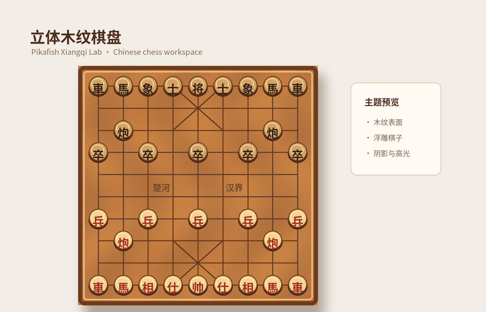
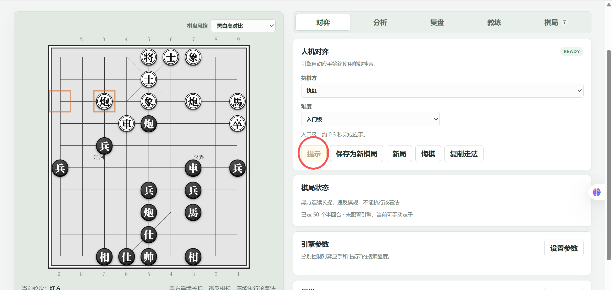

# Pikafish Xiangqi Lab

Pikafish Xiangqi Lab 是一个面向中文用户的象棋大厅与分析工作台。首页提供 20 位明确标注的 AI 棋友，用户可以按“休闲娱乐、日常练习、挑战高手”选择推荐对象，也可以随机挑战；进入对局后复用现有棋盘、五档棋力、提示、分析和复盘能力。

项目坚持“规则优先”：`apps/api/app/xiangqi.py` 和前端规则镜像负责合法着法、将死、困毙、重复局面和长将/长捉判定；Pikafish 只负责评估和候选着法，任何引擎着法落库前都必须重新通过规则校验。

> `start.ps1`（Windows）和 `start.sh`（macOS）用于本机开发和体验，不是生产部署脚本。正式上线前请完成本文的生产配置，并按[账号、隐私与 PostgreSQL 备份运行手册](docs/operations/account-and-backup.md)执行部署检查。

## 项目特点

- **象棋规则优先**：棋盘、走法、将军与终局等规则在项目规则模块校验；引擎着法在执行前仍需校验，避免把引擎评估当作规则裁判。
- **多个对弈强度档位**：提供轻松陪练、入门练习、进阶对手、认真对弈、全力挑战五档。档位是体验预设，不代表经过校准的等级分；分析、提示和复盘仍使用完整引擎分析。
- **分析与复盘**：支持 MultiPV 候选着法、主变化、FEN 局面分析，以及逐半回合复盘；复盘棋谱最多 120 个半回合。复盘弹窗提供“关键时刻”“提示记录”“悔棋记录”三个 Tab，可点击记录还原对应局面并查看棋盘高亮。
- **轻量 AI 陪练**：对弈中点击“复盘”，弹窗回看当前棋谱的最多三个关键时刻、一句话说明和推荐走法；可对比行棋前、实战及推荐局面，并围绕该时刻追问教练。规则确认将死或困毙后自动生成小结，点击“查看小结”打开；关闭窗口继续原对局。小结无需配置大模型，AI 追问需要配置；引擎思考中、摆棋中、无走法或超过 120 个半回合时暂不可复盘。分析使用独立棋谱快照，期间继续下棋不会修改或混入该结果。
- **提示与悔棋记录**：点击“提示一步”后保存当前局面的候选着法、最佳提示和评估信息；点击“悔棋”后保存撤回的半回合及悔棋后的局面。记录在复盘弹窗中分 Tab 展示，点击单条记录可回看当时棋盘；提示、悔棋和前进操作不会破坏主棋谱的一致性。
- **棋局数据持久化与兼容**：账号、棋局、走法记录、提示/悔棋事件、复盘结果和隐私同意记录可保存至数据库或浏览器本地存档；支持游客棋局登录后迁移、旧格式棋局导入、数据导出、账号删除请求及删除恢复流程。
- **AI 棋友大厅**：20 个棋友来自服务端静态目录，保存 `bot_id`、目录版本和创建时快照；推荐和随机挑战由服务端选择，客户端不能覆盖引擎参数。大厅回合支持 `expected_version`、`turn_id` 幂等和 `awaiting_ai` 断线恢复。
- **共享引擎与有界并发**：单 Uvicorn worker 复用一个 Pikafish 进程，最多 1 个搜索和 2 个排队请求，排队最多等待 5 秒；不使用 `Skill Level` 或 `UCI_Elo`，五档棋力由应用层 profile、候选过滤和选招策略控制。
- **游客优先体验**：游客对局先保存在浏览器 `localStorage`；登录并同意隐私后可保存云端正式局。游客局导入账号后不会计入正式战绩，正式统计只纳入明确结束的云端大厅对局。
- **账号选择**：支持第三方 OIDC 登录；未配置 OIDC 时提供邮箱和密码注册/登录。首版默认不要求邮件验证，因此不依赖 SMTP。若启用邮箱验证和密码找回，需另配邮件服务。
- **可选 AI 教练**：未配置大语言模型也可使用引擎对弈、分析和复盘；配置 OpenAI 兼容服务后可进行连续教练问答、思路解释和棋盘图片识别。
- **备份工具**：提供 PostgreSQL 加密备份、Windows 每日计划任务和隔离数据库恢复脚本；备份密钥及删除账本需独立、安全保存。

## 界面预览

### 立体木纹棋盘



应用内棋盘风格选择器提供“立体木纹”主题，包含木纹表面、浮雕棋子和阴影高光。该配图用于展示主题材质；实际棋局状态仍以应用中的规则和棋谱为准。

### 工作台截图



界面左侧是可交互棋盘，右侧提供棋友大厅、对弈、分析、复盘、教练和棋局入口，并集中展示当前对局状态与引擎设置。

大厅展示全部 20 位 AI 棋友、体验分类、推荐棋友、随机挑战和最近棋局；页面不虚构真人在线数量或真人对局。

### 提示、悔棋与复盘记录

1. 在“对弈”页点击“提示一步”，推荐着法会显示在按钮下方，棋盘会高亮起点和目标位置；开启候选着法后还会逐条显示可用候选。
2. 点击“悔棋”可以撤回最近一回合（人机对弈按一红一黑撤回，观战或手动模式按可用步数撤回）；需要恢复时点击“前进”。
3. 点击“复盘”打开复盘弹窗。右侧分别进入“关键时刻”“提示记录”“悔棋记录”Tab，选择记录后左侧棋盘会还原记录对应的局面。进入“棋局”页或载入已保存棋局时，会为当前棋谱自动生成一次小结并保存；已有小结不会重复请求引擎，点击“重新生成”可手工覆盖缓存。
4. 点击“保存为新棋局”后，提示和悔棋记录会随棋局一起保存；之后可在顶部“棋局”入口继续查看、重开或删除棋局。未保存的当前对局记录只保留在当前页面。

## 技术栈

| 部分 | 技术 |
| --- | --- |
| 前端 | Vue 3、TypeScript、Vite、Vitest |
| API | Python 3.11+、FastAPI、Uvicorn、Pydantic |
| 数据存储 | SQLAlchemy、Alembic；生产环境使用 PostgreSQL，未设置数据库地址时本地开发默认 SQLite |
| 身份认证 | OIDC、Argon2 密码哈希、Cookie 会话 |
| 象棋引擎 | Pikafish UCI 与配套 NNUE 网络 |

## V1 架构约束

- AI 棋友目录：`apps/api/app/ai_friends.json`，固定 20 个启用棋友；配置由服务端校验，棋局保存创建时快照。
- 大厅服务：`apps/api/app/game_hall.py` 编排用户着法、AI 搜索、规则复核、棋谱写入和同回合重试。
- 持久化：`Game` 扩展大厅元数据，`GameTurn` 保存幂等回合；迁移文件为 `apps/api/alembic/versions/0007_ai_hall_v1.py`。
- 部署：第一阶段固定一个 Uvicorn worker，避免每个 worker 启动一套 Pikafish。单 worker 最多 3 个在途引擎请求，超出容量或等待超过 5 秒会返回结构化错误。
- 评级范围：V1 不实现 Glicko-2、初始棋力测评、动态评级、能力画像、个性化训练、对局后聊天、好友对弈和排行榜；“推荐棋友”只表达目标体验推荐。

大厅相关接口包括：

| 接口 | 用途 |
| --- | --- |
| `GET /api/ai-friends` | 获取 20 个 AI 棋友目录，可按体验筛选 |
| `POST /api/matches/recommend` | 按休闲、练习或挑战目标推荐棋友 |
| `POST /api/matches/random` | 随机选择棋友 |
| `POST /api/hall/games` | 创建云端 AI 棋友对局 |
| `POST /api/games/{id}/turns` | 提交用户着法并完成可恢复的 AI 回合 |
| `POST /api/games/{id}/resign` | 用户主动认输并记录正式赛果 |
| `GET /api/me/game-stats` | 查询符合资格的大厅正式战绩 |

## 环境准备

- Windows 开发环境：Python 3.11 或更新版本、Node.js/npm。
- PostgreSQL：本地开发可使用 SQLite；需要验证账号、棋局持久化或生产配置时，准备 PostgreSQL 数据库和专用数据库账号。
- Pikafish：从[官方 Releases](https://github.com/official-pikafish/Pikafish/releases)下载与运行平台匹配的程序及 NNUE 文件。引擎可选；不安装时棋盘和局面编辑仍可使用，但无法进行引擎分析。

## 本机开发

### 1. 配置环境变量

后端从项目根目录的 `.env` 读取环境变量。首次运行可创建该文件；不要提交真实密码、令牌或密钥：

```dotenv
# 可省略；省略时使用 apps/api/chess.db 本地 SQLite 数据库
# PostgreSQL 示例请替换账号、密码和主机：
# DATABASE_URL=postgresql+psycopg://<user>:<password>@<host>:5432/chess

# 可选：仅在需要 AI 教练、思路解释或图片识别时配置
AGENT_OPENAI_BASE_URL=https://<openai-compatible-host>/v1
AGENT_OPENAI_API_KEY=<your-api-key>
AGENT_OPENAI_MODEL=<your-model-name>
```

本地会话密钥可设置为随机值，例如在 PowerShell 中生成：

```powershell
python -c "import secrets; print(secrets.token_urlsafe(48))"
```

将输出填入 `.env` 的 `SESSION_SECRET`。正式部署必须设置强随机会话密钥，不能使用开发默认值。

### 2. 安装后端依赖并初始化数据库

在 PowerShell 中：

```powershell
cd D:\chess\apps\api
python -m venv .venv
.\.venv\Scripts\Activate.ps1
python -m pip install -r requirements.txt
alembic upgrade head
```

如果使用 PostgreSQL，请先创建 `chess` 数据库，并在项目根目录 `.env` 设置正确的 `DATABASE_URL`，再执行迁移。当前 Alembic 最新迁移为 `0007_ai_hall_v1`，包含棋局引擎设置、提示/悔棋事件、AI 棋友元数据和可恢复回合存储。执行前请备份已有数据库；不要使用会删除表的重置操作。

### 3. 准备 Pikafish（可选）

Windows x86-64 用户可在项目根目录一键下载安装官方引擎及对应 NNUE：

```powershell
.\scripts\install-engine.ps1
```

预览下载版本而不安装：

```powershell
.\scripts\install-engine.ps1 -WhatIf
```

如需更新现有引擎，加 `-Force`；需要固定版本时传入官方 tag，例如 `-Version Pikafish-2026-09-06`。安装脚本只从 Pikafish 官方 Releases 获取文件，不把引擎二进制存入本项目仓库。也可以从[官方 Releases](https://github.com/official-pikafish/Pikafish/releases)手动下载兼容的引擎与 `.nnue` 放入 `engine` 目录。

Windows 默认查找 `engine/pikafish.exe`；也可以在 `.env` 指定路径：

```dotenv
PIKAFISH_PATH=D:\chess\engine\pikafish.exe
PIKAFISH_EVAL_FILE=D:\chess\engine\pikafish.nnue
```

可查看 [引擎目录说明](engine/README.md)。程序和 NNUE 必须来自相互兼容的版本。

### 4. 启动服务

#### macOS

首次使用需准备 Python 3.11+、Node.js/npm 并安装依赖。例如使用 Homebrew：

```bash
brew install python@3.11 node
cd /path/to/chess
python3.11 -m venv apps/api/.venv
apps/api/.venv/bin/python -m pip install -r apps/api/requirements.txt
(cd apps/web && npm install)
```

可选引擎：从 [Pikafish 官方 Releases](https://github.com/official-pikafish/Pikafish/releases) 下载发布包，取出 `Pikafish-MacOS-universal` 和同包的 `pikafish.nnue`，放入 `engine/Pikafish/`（已忽略）。执行 `chmod +x engine/Pikafish/Pikafish-MacOS-universal`，并在项目根目录 `.env` 配置实际绝对路径：

```dotenv
PIKAFISH_PATH=/path/to/chess/engine/Pikafish/Pikafish-MacOS-universal
PIKAFISH_EVAL_FILE=/path/to/chess/engine/Pikafish/pikafish.nnue
```

按前文说明配置 `SESSION_SECRET` 等本地环境变量，然后运行：

```bash
./start.sh --dry-run  # 预览命令，不创建文件或启动服务
./start.sh            # 后台启动 API 和 Vite，关闭终端后继续运行
./start.sh --restart  # 重启此脚本管理的服务
./start.sh --stop     # 停止此脚本管理的服务及引擎子进程
```

前端为 <http://127.0.0.1:1239/>，健康检查为 <http://127.0.0.1:8000/api/health>。脚本可从其他目录调用，路径包含空格也可使用；固定单 Uvicorn worker，重复启动复用此脚本管理的健康进程。进程日志为 `logs/api-macos.log`、`logs/web-macos.log`，启动时若超过 5 MiB 则保留一份旧日志；运行期间仍会追加。启动失败会显示最近 40 行日志，并清理本次新启动的进程。

脚本不会自动安装依赖、下载引擎或执行数据库迁移；缺少依赖时会给出安装命令。后端继续读取根目录 `.env`，无数据库配置时使用本地 SQLite；已有数据库如需迁移，遵循前文的备份和迁移流程。未配置引擎时前后端仍可启动，但会提示引擎未就绪。端口被其他启动方式占用时会拒绝启动，请先停止旧服务；`--stop` 不会停止其他方式启动的服务。生命周期操作用文件锁串行执行，PID 与进程启动时间一并校验，避免陈旧记录误停其他进程。停止时先向已确认归属的整个进程组发送 SIGTERM，等待 10 秒后仍有存活子进程才发送 SIGKILL。

若父进程意外退出但进程组仍有子进程，脚本会保留记录并报错，显示需要手工检查的进程组编号；归属无法再次确认时不会自动结束这些进程。

#### Windows

推荐在项目根目录运行 Windows 一键开发启动脚本：

```powershell
cd D:\chess
.\start.ps1
```

该脚本启动或复用后端 `127.0.0.1:8000` 和 Vite 前端 `127.0.0.1:1239`，日志写入根目录 `logs/`。可先检查脚本解析出的路径和命令而不启动服务：

```powershell
.\start.ps1 -DryRun
```

### Docker 本机启动

Docker Compose 启动 API 和前端两个容器，并连接 `.env` 中 `DATABASE_URL` 指定的 PostgreSQL。它会复用已经运行的数据库，不会再创建 PostgreSQL 容器。Pikafish 由 API 按需启动，不是单独的容器服务。原有 `start.ps1` 仍用于本机 Python/npm 开发。

确保 Docker Desktop 正在运行。首次启动或更新代码后，在项目根目录构建 API 镜像并应用数据库迁移；已有数据库请先备份：

```powershell
docker compose build api
docker compose run --rm --no-deps api alembic upgrade head
```

首次启动时，`start-docker.ps1` 会自动安装 Linux 引擎，然后启动 API 和前端：

```powershell
.\start-docker.ps1
```

Linux 引擎已安装且数据库迁移完成后，也可以直接运行 `docker compose up --build -d`。前端地址是 <http://127.0.0.1:1240>，API 健康检查地址是 <http://127.0.0.1:8010/api/health>。Docker 版使用独立端口，可以和原来的 `start.ps1` 并行运行。查看容器状态和日志可运行 `docker compose ps`、`docker compose logs -f`；停止本项目容器运行 `docker compose down`，不会停止 PostgreSQL。

API 容器必须能访问 `.env` 中 `DATABASE_URL` 指定的地址。若 PostgreSQL 在这台电脑的 Docker 容器中，连接地址的主机名应使用 `host.docker.internal`，例如 `postgresql+psycopg://postgres:<password>@host.docker.internal:5432/chess`；不要在容器连接地址中使用 `localhost`。

Docker 模式默认只绑定本机地址，使用开发配置，不应用作生产部署。`start-docker.ps1` 会检查 Docker 是否使用 Linux x86-64 容器；如果缺少 Linux 引擎或 NNUE，它会从 Pikafish 官方 Releases 下载并安装匹配文件到 `engine/linux-x86-64/`，然后启动 API 和前端。首次使用需要能够访问 GitHub。启动时 API 容器会复制引擎到容器内并设置执行权限，因此宿主机现有的 Windows `pikafish.exe` 不会影响 Docker 分析。安装脚本及手动安装步骤见 [引擎目录说明](engine/README.md)。

也可以分别启动，便于调试：

```powershell
# 终端一：后端（固定单 worker）
cd D:\chess\apps\api
.\.venv\Scripts\Activate.ps1
uvicorn app.main:app --host 127.0.0.1 --port 8000 --workers 1

# 终端二：前端
cd D:\chess\apps\web
npm install
npm run dev
```

打开 <http://127.0.0.1:1239>。API 健康检查地址为 <http://127.0.0.1:8000/api/health>。停止 `start.ps1` 启动的服务时，请停止对应的 API、Vite 和 Pikafish 子进程，不要结束其他项目的 Node/Python 进程。

## 生产部署流程

仓库提供本机开发用的 Docker Compose 启动方式，但不包含生产 Docker、进程管理器或反向代理配置。下面是生产部署步骤和边界；需由部署环境提供 HTTPS、静态文件服务、进程守护和 PostgreSQL 运维。

1. **准备运行环境**：部署前端静态文件和 API 到受控主机；安装 Python 3.11+、Node.js 构建环境、PostgreSQL 客户端工具，以及与服务器平台匹配的 Pikafish 和 NNUE。
2. **准备 PostgreSQL**：创建独立数据库和权限受限的服务账号；配置防火墙、网络访问和定期维护。不要在公网暴露数据库端口。
3. **配置生产密钥与隐私信息**：通过服务管理器或密钥管理系统注入环境变量，不要将 `.env`、密钥或真实凭据放入版本库。生产模式要求以下配置齐全，否则 API 会拒绝启动：

   ```dotenv
   APP_ENV=production
   DATABASE_URL=postgresql+psycopg://<user>:<password>@<private-host>:5432/chess
   SESSION_SECRET=<至少 32 个字符的随机值>
   COOKIE_SECURE=1
   PUBLIC_BASE_URL=https://<your-domain>
   PRIVACY_POLICY_VERSION=v1.0
   PRIVACY_OPERATOR_NAME=<实际运营主体>
   PRIVACY_CONTACT_EMAIL=<隐私联系邮箱>
   PRIVACY_EFFECTIVE_DATE=<YYYY-MM-DD>
   PRIVACY_THIRD_PARTY_DISCLOSURE=<第三方服务、处理地点及数据说明>
   PRIVACY_BACKUP_STORAGE_DESCRIPTION=<备份位置及保留安排>
   PRIVACY_POLICY_APPROVED=1
   BACKUP_OUTPUT_DIR=<备份目录>
   DELETION_LEDGER_PATH=<独立保存的删除账本路径>
   BACKUP_ENCRYPTION_KEY=<32 字节随机密钥的 Base64>
   ```

   `PRIVACY_POLICY_APPROVED=1` 是运营方完成内容核实后设置的发布门槛，不代替法律审核。隐私页面会读取运营主体、联系邮箱和政策说明；部署前应核验页面展示内容与实际数据处理相符。

4. **运行数据库迁移**：在发布新版本前备份数据库，再从 `apps/api` 执行 `alembic upgrade head`。应用启动时会检查生产数据库的 Alembic 版本，不匹配则拒绝启动。
5. **构建前端并托管静态文件**：执行 `cd apps/web; npm install; npm run build`，将 `apps/web/dist` 发布到 HTTPS 站点。仓库当前未包含 npm lock 文件，因此这里使用 `npm install`。由 Nginx、Caddy 或云负载均衡将 `/api` 和 `/auth` 转发给仅监听内网的 Uvicorn API。设置正确的 Host、转发协议和 Cookie 安全属性。
6. **守护 API 进程**：在 `apps/api` 的 Python 环境中运行 `uvicorn app.main:app --host 127.0.0.1 --port 8000`，由 systemd、Windows 服务管理器或容器平台负责启动和守护；生产中不要使用 `--reload` 或 Vite 开发服务器。Uvicorn 应仅对反向代理开放，并配置进程重启策略、日志收集、资源限制和健康检查。

   Linux 使用 systemd 时，可以按下面的示例部署。Pikafish 不需要单独注册为 systemd 服务；API 会按需启动 Pikafish 子进程，并通过 UCI 协议与其通信。

   **准备 Pikafish 和 API 运行目录**（以下假设项目部署在 `/opt/pikafish-lab`，服务账号为 `chess`）：

   ```bash
   sudo useradd --system --home-dir /opt/pikafish-lab --shell /usr/sbin/nologin chess
   sudo install -d -o chess -g chess /opt/pikafish-lab/engine /opt/pikafish-lab/logs

   # 从 Pikafish 官方 Releases 下载与服务器架构匹配的 Linux 二进制和 NNUE 文件
   sudo install -o chess -g chess -m 0755 pikafish /opt/pikafish-lab/engine/pikafish
   sudo install -o chess -g chess -m 0644 pikafish.nnue /opt/pikafish-lab/engine/pikafish.nnue

   cd /opt/pikafish-lab/apps/api
   python3.11 -m venv .venv
   . .venv/bin/activate
   python -m pip install -r requirements.txt
   deactivate
   ```

   **创建生产环境文件** `/etc/pikafish-lab/api.env`。将第 3 步要求的生产变量一并写入此文件，至少包含 Pikafish 路径：

   ```dotenv
   APP_ENV=production
   PIKAFISH_PATH=/opt/pikafish-lab/engine/pikafish
   PIKAFISH_EVAL_FILE=/opt/pikafish-lab/engine/pikafish.nnue
   ```

   环境文件包含会话密钥、数据库密码等敏感信息，应限制读取权限：

   ```bash
   sudo chown root:chess /etc/pikafish-lab/api.env
   sudo chmod 0640 /etc/pikafish-lab/api.env
   ```

   **创建 systemd 单元** `/etc/systemd/system/pikafish-lab-api.service`：

   ```ini
   [Unit]
   Description=Pikafish Xiangqi Lab API
   After=network-online.target
   Wants=network-online.target

   [Service]
   Type=simple
   User=chess
   Group=chess
   WorkingDirectory=/opt/pikafish-lab
   EnvironmentFile=/etc/pikafish-lab/api.env
   ExecStart=/opt/pikafish-lab/apps/api/.venv/bin/python -m uvicorn app.main:app --host 127.0.0.1 --port 8000
   Restart=on-failure
   RestartSec=5
   TimeoutStopSec=15
   NoNewPrivileges=true
   PrivateTmp=true

   [Install]
   WantedBy=multi-user.target
   ```

   **启用并检查服务**：

   ```bash
   sudo systemctl daemon-reload
   sudo systemctl enable --now pikafish-lab-api
   sudo systemctl status pikafish-lab-api
   sudo journalctl -u pikafish-lab-api -f
   curl --fail http://127.0.0.1:8000/api/health
   ```

   如果健康检查正常但引擎不可用，先检查 `PIKAFISH_PATH` 是否可执行、NNUE 路径是否存在，以及服务账号是否有读取和执行权限。引擎启动、UCI 握手和搜索错误会同时记录到项目 `logs/api.log` 和 systemd 日志中。
7. **验证发布与恢复流程**：检查 `/api/health`、注册/登录、棋局存取、引擎状态、隐私政策状态和 HTTPS Cookie；按[运行手册](docs/operations/account-and-backup.md)配置加密备份、计划任务及恢复演练。

OIDC 如需启用，另行配置 `OIDC_ISSUER`、`OIDC_CLIENT_ID`、`OIDC_CLIENT_SECRET` 和与身份提供商登记地址一致的 `OIDC_REDIRECT_URI`。邮箱密码注册/登录默认不要求验证邮件；启用 `EMAIL_VERIFICATION_REQUIRED=true` 后，必须配置 SMTP 邮件发送参数及 HTTPS `PUBLIC_BASE_URL`。

**发布注意事项：** 当前仓库提供的是应用代码与备份脚本，不包含可直接上线的完整基础设施配置。备份是每日全量方案；WAL/PITR、异地复制、告警、RPO/RTO 目标需要结合实际 PostgreSQL 服务单独配置并通过演练验证。尚未填入真实运营主体、隐私联系方式、第三方披露、密钥和备份存储配置前，不应把站点视为可正式运营。

## 按环境运行测试

各环境都需要 Python 3.11+、Node.js/npm。先按本机开发步骤安装 `apps/api/requirements.txt` 和前端 npm 依赖；`.venv`、`node_modules` 应在目标平台重新创建，不跨系统复制。下面分别使用项目虚拟环境中的 Python，无需先激活虚拟环境。

### macOS（zsh/Bash）

系统需提供 Bash 和 `ps`。将 `/path/to/chess` 替换为实际项目路径：

```bash
cd /path/to/chess/apps/api
.venv/bin/python -m pytest -q -rs

# 按需定位启动脚本或大厅相关问题
.venv/bin/python -m pytest -q -rs tests/test_start_macos.py
.venv/bin/python -m pytest -q -rs tests/test_ai_friends.py tests/test_engine_concurrency.py tests/test_game_hall_api.py

cd ../web
npm test
npm run build

# 仅显示启动命令，不启动服务或创建日志
cd ../..
./start.sh --dry-run
```

### Windows（PowerShell）

运行 Windows 启动脚本测试需要能在 PATH 中找到 `pwsh` 或 `powershell`。缺少该工具时测试仍会失败，需要安装或修复 PATH；不会因为缺少工具而自动算作通过。

```powershell
cd D:\chess\apps\api
.\.venv\Scripts\python.exe -m pytest -q -rs

# 按需定位启动脚本或大厅相关问题
.\.venv\Scripts\python.exe -m pytest -q -rs tests/test_start_dev_script.py
.\.venv\Scripts\python.exe -m pytest -q -rs tests/test_ai_friends.py tests/test_engine_concurrency.py tests/test_game_hall_api.py

cd ..\web
npm test
npm run build

cd ..\..
.\start.ps1 -DryRun
```

### Linux / WSL（Bash）

使用 Linux 环境中的 Python、Node.js/npm 和依赖。安装 Bash 与提供 `ps` 的工具包（常见名称为 `procps` 或 `procps-ng`），并允许创建本机监听端口和进程组。后端测试会执行 POSIX 启动脚本测试：

```bash
cd /path/to/chess/apps/api
.venv/bin/python -m pytest -q -rs
.venv/bin/python -m pytest -q -rs tests/test_start_macos.py

cd ../web
npm test
npm run build
```

WSL 按 Linux 处理；验证 Windows 启动脚本时，需回到 Windows PowerShell 使用 Windows 虚拟环境。Linux 上通过 POSIX 测试不代表已经验证 macOS 实机或 macOS Pikafish 二进制。

### 平台跳过规则与结果解读

| 测试类别 | macOS | Windows | Linux / WSL |
| --- | --- | --- | --- |
| 象棋规则、接口、日志等通用后端测试 | 执行 | 执行 | 执行 |
| Windows 启动脚本运行测试（`test_start_dev_script.py` 中的 3 项） | 跳过 | 执行，需 PowerShell | 跳过 |
| Windows 启动脚本静态检查 | 执行 | 执行 | 执行 |
| POSIX 启动脚本测试（`test_start_macos.py`） | 执行 | 跳过 | 执行，需 Bash、`ps` |
| 前端 `npm test` 与 `npm run build` | 执行 | 执行 | 执行 |

`-rs` 会列出跳过原因。报告应包含运行环境、实际命令及通过、失败、跳过的数量；数量以本次输出为准，不使用历史结果代替。按平台跳过不等于在对应平台验证通过；通用测试失败或适用平台缺少必需工具时仍应排查。

启动脚本修改还需在目标系统验证实际启动、重复启动、停止、重启、端口冲突及引擎状态。真实引擎检查可在启动后访问 `/api/health`，并执行一次引擎搜索；测试和构建通过不代表引擎二进制及 NNUE 已正确安装。

### 测试数据库、并发与 CI/容器

后端 `tests/conftest.py` 将数据库地址固定为 `sqlite+pysqlite:///./test_suite.db`，即当前工作目录下的测试库。请按上述命令在 `apps/api` 中串行运行后端测试，不要同时启动多个 pytest 进程或使用 `pytest -n` 共享此库；代码审查或子代理也应遵守。需要并行验证时，为每个进程分配独立工作目录和测试库。仅在命令外设置 `DATABASE_URL` 无法覆盖此配置。不要提交测试数据库、journal/WAL 文件或日志。

CI 和容器按执行环境选择测试。Linux 容器无法代替 Windows 或 macOS 验证；精简镜像还需补齐 Bash、`ps` 等适用测试工具，不能假定用于启动 API 的镜像已包含完整测试环境。跨平台发布时分别记录各目标系统的测试和构建结果。

## 相关文档

- [账号、隐私与 PostgreSQL 备份运行手册](docs/operations/account-and-backup.md)：生产配置、加密备份、计划任务和恢复演练。
- [Pikafish 引擎目录说明](engine/README.md)：引擎和 NNUE 安装方式。
- [AI 棋友平台现状审查方案](docs/architecture/xiangqi-ai-hall-upgrade-proposal.md)：项目结构、引擎复用、对局数据和改造边界。
- [象棋大厅 V1 实施计划](docs/superpowers/plans/2026-11-08-xiangqi-hall-v1-implementation-plan.md)：P0～P6 任务、接口合同、状态流转和验收记录。
- [项目研发规范](AGENTS.md)：象棋规则、棋盘坐标、存档及测试要求。
