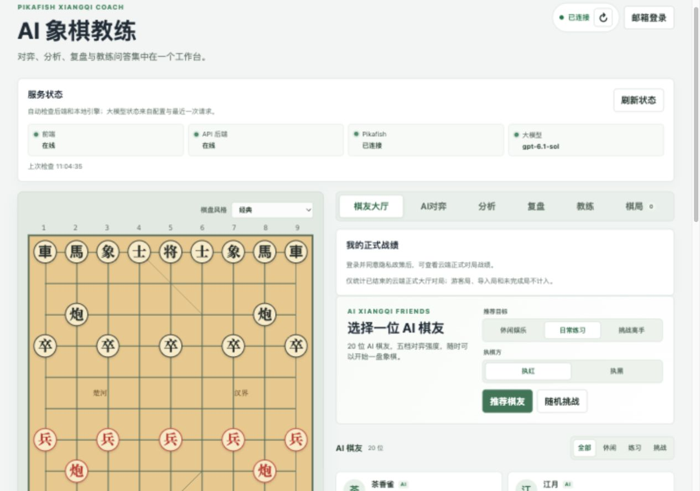

# V1 完善与验收记录（2026-11-15）

本轮完善现有 AI 棋友大厅 V1，不引入用户评级、能力雷达、个性化训练、真人对弈或排行榜。以下记录补充并更新实施计划第 8 节的历史验收状态，不代表生产环境已经完成部署验收。

## 本轮交付

- 首页接入现有正式战绩接口，展示总局数、胜、负、和；区分游客、隐私未同意、加载、空数据和请求失败。账号切换立即清空旧战绩，过期响应不能覆盖新账号数据；完成正式局和成功删除后刷新统计。
- 当前对局、最近对局与棋谱列表统一显示中文赛果及结束原因；用户执黑时胜负按用户视角展示。
- 推荐棋友、随机挑战遵循用户选择的执红/执黑；修复执黑开局重复触发普通引擎请求，增加目录失败重试和加载期间操作限制。
- AI 待恢复回合禁止继续落子和悔棋；恢复入口不再依赖临时错误消息，兼容旧存档中已有的待恢复状态。游客重试成功后回到进行中，不重复保存用户着法。
- 已结束棋局禁止继续落子；正式云端局禁用本地悔棋。认输立即保存本地检查点；删除失败保留原记录。新建独立 FEN 局面或完成摆棋后清除上局大厅会话状态。
- 增加大厅、战绩和根组件的 DOM 交互回归，覆盖账号响应竞态、执黑开局、失败恢复、重复着法、删除及结束状态。
- 后端测试统一使用 `conftest.py` 的测试库配置，移除四个测试模块导入时对全局数据库地址的覆盖。忽略外置盘产生的 AppleDouble `._*` 元数据，避免被当成源码或测试解析。
- 更新单 worker 生产启动示例与当前 Alembic 版本说明。本轮未修改后端业务模型、未新增迁移、未迁移项目数据库。

## 自动化检查

实际环境：macOS / Darwin，zsh 5.9；项目虚拟环境 Python 3.11.12，Node.js 22.16.0，npm 10.9.2。后端使用本机 `apps/api/.venv`，未使用系统 Python 3.9。后端 pytest 串行执行，同一工作目录没有并发 pytest 进程。

| 工作目录 | 实际命令 | 结果 |
| --- | --- | --- |
| `apps/api` | `.venv/bin/python -m pytest -q -rs` | 189 通过、0 失败、3 跳过；33.85 秒 |
| `apps/api` | `.venv/bin/python -m pytest -q -rs tests/test_ai_friends.py tests/test_engine_concurrency.py tests/test_game_hall_api.py tests/test_start_macos.py` | 33 通过、0 失败、0 跳过；8.07 秒 |
| `apps/web` | `npm test` | 26 个文件、110 项通过，0 失败、0 跳过；5.03 秒 |
| `apps/web` | `npm run build` | `vue-tsc --noEmit` 与 Vite 生产构建通过 |
| 项目根目录 | `./start.sh --dry-run` | 通过；启动命令包含 `--workers 1` |
| 项目根目录 | `git diff --check` | 通过 |

后端全量的 3 项跳过均位于 `tests/test_start_dev_script.py`（第 13、90、117 行），原因是运行测试需要 Windows 和 PowerShell；Windows 脚本静态检查仍执行。两项非失败警告分别来自 Starlette TestClient 的 httpx 弃用提醒和 Authlib jose 弃用提醒。npm 另外提示用户级 Electron 镜像配置将被未来版本弃用。

## 真实引擎与持久化冒烟

在项目根目录执行一次性隔离脚本 `apps/api/.venv/bin/python /tmp/chess-v1-live-smoke.py`。脚本使用临时 SQLite 数据库、临时端口、开发认证和实际 macOS Pikafish 二进制，启动参数固定 `uvicorn --workers 1`。检查完成后关闭自己启动的 API/引擎并删除临时数据库，未停止已有开发服务。

实际通过的场景：

1. 查询 Alembic head，在隔离 SQLite 库升级、备份、降级至 `0006`、重新升级至 `0007_ai_hall_v1`。
2. 加载 20 个棋友目录，对五档 profile 分别完成用户一步和 AI 应手，并通过规则层重建校验完整走法历史；相同回合重复请求不增加着法和版本，随后主动认输。
3. 用户执黑时保存 AI 开局；实际停止并重新启动隔离 API 后，已完成回合重复请求仍保持同一棋谱。
4. 六局正式认输计入六负；其他账号无法读取棋局；删除其中一局后正式统计变为五局。
5. 四个真实并发搜索得到三个成功和一个结构化 `429 queue_full`，符合一个搜索加两个排队的容量；重置后再次搜索成功。

这些是真实引擎的有限冒烟场景，不代表完整长局、所有棋友风格或真实进程异常退出均已逐项演练。超时、取消和非法候选恢复由自动化测试覆盖。

## 界面检查

实际浏览器检查游客大厅、20 个棋友、分类筛选及切回全部；手机宽度约 394px 和桌面 1280×900 均检查，桌面未出现横向溢出。截图为游客状态；登录后的统计数值和错误交互由 DOM/API 测试覆盖。

[手机大厅截图](../images/v1-hall-mobile.jpg)

## 仍需在目标环境完成

- Windows PowerShell 与 Linux 原生启停验证；本轮 macOS 结果不能代替其他平台。
- 生产 PostgreSQL 的实际 head 核对、备份、隔离恢复及迁移演练；本轮 SQLite 验证不能代替 PostgreSQL。
- 按[账号、隐私与备份运行手册](account-and-backup.md)配置实际运营主体、隐私披露、邮件/OIDC、密钥、HTTPS、备份与进程守护，完成部署后的端到端验收。

用户棋力测评、动态评级、能力画像、个性化训练、对局后聊天等仍按现有架构边界留待后续版本。
