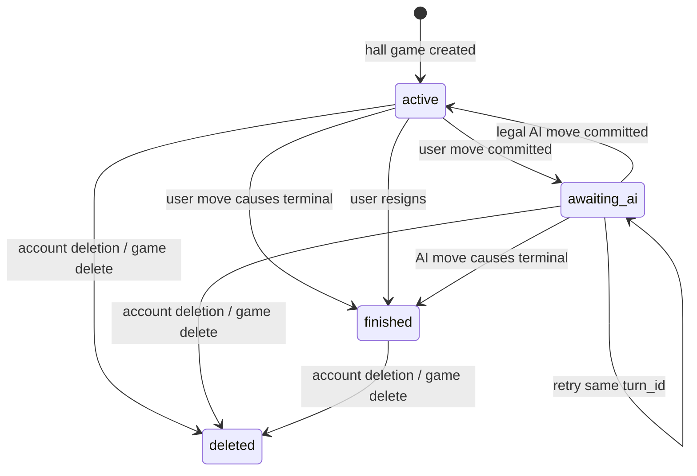
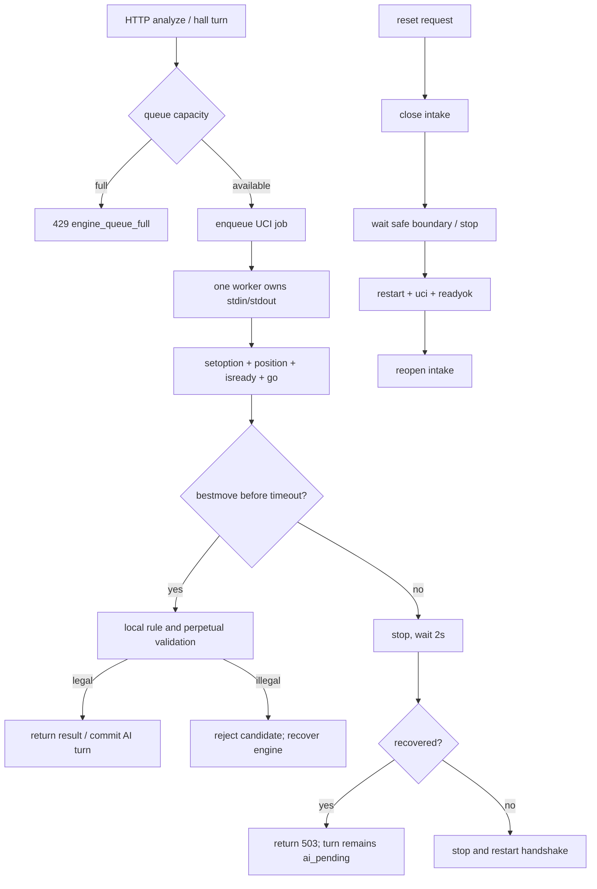

# 象棋大厅 V1.0 最终技术实施方案

> **For agentic workers:** REQUIRED SUB-SKILL: Use superpowers:subagent-driven-development or superpowers:executing-plans to implement this plan task-by-task. Each phase has its own test gate.

**Goal:** 在现有 Pikafish Xiangqi Lab 上增加 20 个明确标注的 AI 棋友、推荐/随机挑战、可恢复的服务端完整回合、正式赛果和游客到账号的兼容流程。

**Architecture:** 机器人采用随应用发布的静态 JSON 目录，每个 `Game` 保存机器人 id、目录版本和创建时配置快照。每个 API worker 继续复用一个 `PikafishEngine`，通过有界异步队列串行发送 UCI 命令；大厅回合用持久化 `GameTurn` 记录幂等状态，数据库事务只包围短时状态更新，绝不覆盖旧对局。

**Tech Stack:** Vue 3、TypeScript、Vite、Vitest、FastAPI、Pydantic、SQLAlchemy、Alembic、SQLite/PostgreSQL、Pikafish UCI。

**Spec:** 本文即 V1.0 定稿；现状依据 `docs/architecture/xiangqi-ai-hall-upgrade-proposal.md`、`AGENTS.md` 和当前源码。

## Global Constraints

- 规则判断优先于界面和引擎；所有用户着法、AI 着法、提示和恢复操作复用 `apps/api/app/xiangqi.py`。
- 保留 `companion`、`beginner`、`progress`、`serious`、`full` 五档及其现有 API 语义。
- 不使用 Pikafish `Skill Level` 或 `UCI_Elo`，不为 20 个棋友启动 20 套引擎。
- 第一阶段只有 AI 对手；不展示真人在线数、真人对局或未标记的演示动态。
- 生产固定一个 Uvicorn worker；引擎最多接纳 3 个在途请求，即 1 个运行、2 个排队，其他请求立即收到有界负载错误。
- 游客正式体验优先写入现有 localStorage；未登录游客局不进入账号正式战绩。
- 游客棋局导入账号后始终 `counts_for_stats=false`，不得通过导入改变正式战绩资格。
- 将死、困毙、规则性和棋和主动认输由规则/业务动作决定，不由 cp、mate 或胜率猜测。
- 中途退出、浏览器关闭、引擎异常、本地摆棋、分析、复盘和未完成局不计入正式战绩；第一阶段不实现超时判负。
- 不改回已发布迁移；新增迁移必须以实际数据库版本核验结果为依据，执行前备份并在隔离库演练。
- 不引入 Vue Router、消息队列或新的后端框架；只拆分大厅职责需要的模块。

---

## 1. V1.0 产品与数据合同（P0）

### 1.1 机器人合同

待新增 `apps/api/app/ai_friends.json`，根结构固定为：

```json
{
  "catalog_version": "v1",
  "friends": [
    {
      "bot_id": "lantern-scholar",
      "name": "灯下棋士",
      "avatar_key": "lantern-scholar",
      "description": "稳健布局，适合日常练习。",
      "category": "practice",
      "style": ["稳健", "重视子力协调"],
      "personality": ["耐心", "克制"],
      "strength_profile": "progress",
      "config_version": "v1",
      "enabled": true,
      "sort_order": 10
    }
  ]
}
```

20 个 `bot_id` 全局唯一且只允许 `[a-z0-9-]`；`strength_profile` 只能引用现有五档；目录加载时校验数量、字段、profile、版本和启用状态。`avatar_key` 只是资源键，不接受远程 URL，不伪造真人头像或在线状态。展示分类统一为 `casual`（休闲娱乐）、`practice`（日常练习）、`challenge`（挑战高手）；一个机器人可以出现在多个推荐候选中，但目录只保存一个主分类。

### 1.2 对局合同

修改 `apps/api/app/persistence.py` 的 `Game`：

| 字段 | 类型/默认值 | 说明 |
| --- | --- | --- |
| `mode` | `String(24)`, default `legacy` | `ai_hall`、`legacy`；旧局统一兼容为 `legacy`。 |
| `user_side` | `String(8)`, nullable | `red`/`black`；旧局为空。 |
| `opponent_id` | `String(64)`, nullable | 静态目录 id；旧局为空。 |
| `opponent_config_version` | `String(32)`, nullable | 建局时目录版本。 |
| `opponent_snapshot` | JSON, nullable | 名称、头像键、分类、棋风、性格、strength profile 的不可变快照。 |
| `result` | `String(16)`, nullable | `red_win`、`black_win`、`draw`；未完成为空。 |
| `termination_reason` | `String(32)`, nullable | `checkmate`、`stalemate`、`rule_draw`、`resignation`。 |
| `finished_at` | timezone datetime, nullable | 正式结束时间。 |
| `origin` | `String(24)`, default `cloud_formal` | `cloud_formal`、`guest_local`、`guest_import`、`legacy`。 |
| `counts_for_stats` | Boolean, default false | 仅符合正式战绩条件的云端人机局为 true。 |

`status` 保留已有 `active`、`finished`、`deleted`，新增 `awaiting_ai`。`awaiting_ai` 表示用户着法已经成功落库，AI 着法尚未完成，不能再接受另一条用户着法；它不是正式结果。

待新增 `GameTurn` 表（`apps/api/app/persistence.py`）：`turn_id` 主键、`game_id` 外键、`request_fingerprint`、`expected_version`、`user_uci` nullable、`user_ply`、`ai_uci` nullable、`ai_ply` nullable、`status`（`ai_pending`/`completed`/`rejected`）、`error_code` nullable、`attempt_count`、`created_at`、`updated_at`。唯一约束为 `(game_id, turn_id)`；`request_fingerprint` 由规范化 JSON 哈希得到，保证同一 `turn_id` 不能换棋谱或参数。

### 1.3 赛果合同

- 规则层返回将死：被将死方失败，另一方胜；`termination_reason=checkmate`。
- 规则层返回困毙：按项目规则定义的胜负结果写入；`termination_reason=stalemate`。若现有 `terminal_status()` 只返回 `stalemate` 而未携带胜方，新增明确的规则结果函数，禁止在路由层猜测。
- 规则性和棋：只有经确认的项目规则函数明确返回 draw 时，才写 `result=draw`、`termination_reason=rule_draw`。当前 `xiangqi.py` 可检测重复局面所涉及的长将/长捉，但不能据此推断普通三次重复自动和棋；P0 必须先明确普通重复、其他和棋规则的判据并补规则测试，确认前不得自动判和。
- 用户主动认输：认输方失败，对方胜；`termination_reason=resignation`。
- 中途退出、浏览器关闭、引擎异常、摆棋/分析/复盘和未完成局：`result=NULL`、`counts_for_stats=false`。
- 重开：创建新的 `Game` 和新的 `GameTurn`，旧记录只读保留。

正式战绩查询只统计 `mode=ai_hall AND status=finished AND counts_for_stats=true`，并按 `result` 聚合红胜/黑胜/和棋。所有游客局及其登录后的导入副本统一使用 `origin=guest_import, counts_for_stats=false`，不得通过导入改变正式战绩资格；只有用户从大厅新建的、符合隐私同意的云端正式局，才允许在完成规则终局或认输后计入战绩。

### 1.4 游客和账号生命周期

- 游客 localStorage 记录使用现有 `apps/web/src/App.vue`、`legacyGameMigration.ts` 的格式扩展 `mode`、`opponent_id`、`turn_id`、`origin`；游客局不调用云端战绩接口。
- 登录且通过 `get_consented_user` 后，用户可选择导入游客局。导入请求必须携带完整 `initial_fen + moves + opponent_snapshot`，后端重新 `validate_history()`，不能信任客户端的当前 FEN、结果或赛果字段。
- 导入保留原 local id 为 `legacy_id`，沿用现有唯一约束和冲突响应；服务端生成新的云端 Game id。导入成功后客户端只替换映射，不删除本地副本，直到云端返回成功并完成一次读取校验。
- 用户导出必须把机器人快照、对局元数据、GameTurn 和棋谱写入现有导出包；账号删除沿用现有级联删除和删除账本，不新增绕过路径。

## 2. API 设计（P0/P4）

所有新端点沿用 `apps/api/app/main.py` 的请求 id、结构化错误和 `get_consented_user`；目录读取端点可允许游客访问，正式对局和统计必须登录并满足隐私同意。客户端只能发送体验类别、棋友 id、棋谱和幂等字段，不能发送引擎 depth、Threads、Hash、MultiPV 或候选阈值。

### 2.1 目录与匹配

`GET /api/ai-friends?experience=casual|practice|challenge`：返回 `{catalog_version, friends:[AiFriendSummary], recommended_ids: string[]}`。无 experience 时返回全部启用的 20 个；非法值返回 400 `invalid_experience`。

`POST /api/matches/recommend`：

```json
{"experience":"practice"}
```

返回 `201`：`{match_type:"recommend", experience, opponent:AiFriendSummary, catalog_version}`。推荐逻辑只按分类/标签筛选；没有用户棋力数据时从候选中使用安全随机选择，响应文案明确“按目标体验推荐”，不出现匹配分/Elo。

`POST /api/matches/random`：请求 `{exclude_opponent_ids?: string[]}`，服务端从启用目录中随机选择；排除项为空或排除全部时回退到全部启用目录。返回同上，`match_type:"random"`。

### 2.2 建局、完整回合、认输和结果

`POST /api/hall/games`：

```json
{"opponent_id":"lantern-scholar","user_side":"red","name":"灯下练习"}
```

服务端生成标准起始 FEN 或当前大厅默认局面，读取目录快照，创建 `mode=ai_hall`、`origin=cloud_formal` 的 Game。游客使用同一响应结构但只在浏览器创建 local record，不把游客请求伪装成已登录云端局。若 `user_side=black`，客户端随后调用一次 `POST /turns`，请求不带 `user_uci`，让服务端完成 AI 开局着法。

`POST /api/games/{game_id}/turns`：

```json
{
  "turn_id":"turn-01J...",
  "expected_version":12,
  "user_uci":"h2e2"
}
```

`user_uci` 在当前行棋方为用户时必填；当前行棋方为 AI 时必须为空，仅用于 AI 开局或恢复。响应包含：

```json
{
  "turn_id":"turn-01J...",
  "turn_status":"completed",
  "game": {"id":"...","status":"active","version":14,"current_fen":"...","moves":[]},
  "user_move": {"ply":13,"uci":"h2e2","before_fen":"...","after_fen":"..."},
  "ai_move": {"ply":14,"uci":"h7e7","before_fen":"...","after_fen":"..."}
}
```

新请求流程：验证身份、Game 模式、turn fingerprint 和 `expected_version`；短事务校验当前历史并追加用户着法，若未终局则写 `GameTurn(ai_pending)`、将 Game 置为 `awaiting_ai` 并提交；事务结束后进入引擎队列；AI 返回后再次从数据库读取并校验 turn/game 版本，重新用规则层验证 AI 着法，再以条件更新追加 AI `GameMove`、更新 Game 和 turn。任何一阶段提交失败都不重复插入同一 ply。

重复请求：同 `turn_id`、同 fingerprint 且 `completed` 时返回原结果；`ai_pending` 时继续/重试 AI 阶段；fingerprint 不同返回 409 `turn_conflict`；不同 `expected_version` 返回 409 `stale_game`。客户端断线和服务重启都只留下 `ai_pending`，下次重发同一 turn 即可恢复。

引擎超时、进程退出、队列满或候选均非法：保留用户着法和 `awaiting_ai`，turn 保持 `ai_pending`，记录有限长度 `error_code` 和 `attempt_count`，返回 503/429 的结构化错误。重试成功后正常追加 AI 着法；重试前不允许用户继续落子。若用户着法本身导致终局，则不搜索 AI，turn 直接 `completed`，Game 写正式结果。

`POST /api/games/{game_id}/resign`：请求 `{expected_version, request_id}`；只允许 active 的大厅局，条件更新为 finished/result/`resignation`，重复 request_id 返回原结果。`POST /api/games/{game_id}/turns/{turn_id}/retry` 不单独新增：使用上述 turns 端点重发同一 payload 即可恢复。

`GET /api/games/{game_id}/result`：只返回已结束正式结果；未结束返回 409 `game_not_finished`，删除或非本人返回 404。响应包括 `result`、`termination_reason`、双方名称、finished_at、`counts_for_stats`。

`GET /api/me/game-stats?opponent_id=...`：聚合正式战绩，返回 `{total, red_wins, black_wins, draws, wins, losses}`；无数据返回零值，不创建用户 rating。

现有 `POST /api/games`、`POST /api/games/{id}/moves`、`POST /api/engine/move` 保留，用于旧存档、手动/研究流程和兼容调用；新大厅 UI 不再把 `/api/engine/move` 与云端追加着法拼成完整回合。

## 3. 对局状态流转



`awaiting_ai` 是唯一可恢复的搜索中间态；它不计入战绩，不允许新用户着法。`finished` 只能由规则终局或认输写入正式结果；`deleted` 不出现在普通历史和统计中。

## 4. 引擎生命周期和并发控制（P1）

修改 `apps/api/app/engine.py`：将生命周期和搜索统一放进同一 worker-owned coordinator。推荐接口：`EngineCoordinator.submit(request, *, wait_timeout)`、`reset()`、`stop()`、`start()`；内部有界队列最多容纳 3 个在途任务（1 个运行、2 个排队）、单一 worker task 和 `asyncio.Lock` 只允许一个 UCI 命令序列运行。若暂不引入 coordinator 类，至少把现有 `lock` 扩展为覆盖 start/reset/stop/analyze 的生命周期锁，并用 `asyncio.Condition` 管理有界队列；不得让 reset 直接杀掉搜索中的 process。

配置来自 `apps/api/app/settings.py` 或环境变量，默认最多 3 个在途任务（1 个运行、2 个排队），最大排队等待 5 秒；搜索超时继续以现有 `PIKAFISH_TIMEOUT_SECONDS` 和请求 profile 上限为基础。超过 3 个在途任务立即返回 429 `engine_queue_full`；排队 5 秒未开始返回 503 `engine_queue_timeout`；搜索超时先发送 `stop`，2 秒内收不到 `bestmove` 才停止并重启进程。所有异常都释放队列槽位和锁。

取消语义：请求协程取消只取消等待者，不取消已提交的 UCI job；job 继续到 `bestmove` 或超时，若大厅请求已断开，`GameTurn` 仍可通过同 turn_id 恢复。若实现环境无法保证后台 job 存活，则在取消时明确把 turn 留在 `ai_pending` 并执行 stop/恢复，下一次请求重新排队；不能把半个 UCI 会话交给下一个请求。

reset 语义：设置 `reset_requested`，阻止新 job 入队；等待当前 job 到达安全边界或执行 stop，清理旧 stdout/stderr，重新握手并 `isready`，最后开放队列。reset 失败时保留 `ready=false`，后续 job 返回 503，不伪造成功。



第一阶段部署固定单 API worker；启动脚本/生产配置需明确 `--workers 1`，避免每 worker 启动一套引擎。跨进程单引擎 broker 留给后续版本。

## 5. 完整文件清单

### 5.1 待新增文件

| 文件 | 所属阶段 | 职责 |
| --- | --- | --- |
| `apps/api/app/ai_friends.json` | P2 | 20 个机器人目录和 catalog version。 |
| `apps/api/app/ai_friends.py` | P2 | JSON 加载、schema 校验、按体验推荐、随机选择、快照生成。 |
| `apps/api/app/game_hall.py` | P3/P4 | 建局、turn 幂等、用户/AI 两段提交、恢复、认输和赛果服务函数。 |
| `apps/api/alembic/versions/0007_ai_hall_v1.py` | P4 | Game 新字段、GameTurn 表、索引和唯一约束；编号以真实 head 核验后确定。 |
| `apps/api/tests/test_ai_friends.py` | P2/P6 | 20 条配置、字段、启用、分类、profile 和选择边界。 |
| `apps/api/tests/test_engine_concurrency.py` | P1/P6 | 队列、互斥、reset、超时、取消和恢复。 |
| `apps/api/tests/test_game_hall.py` | P3/P4/P6 | 完整回合、幂等、失败恢复、赛果、认输和隔离。 |
| `apps/api/tests/test_game_hall_api.py` | P4/P6 | FastAPI 端点、状态码、旧接口兼容和错误合同。 |
| `apps/web/src/components/AiFriendView.vue` | P5 | 大厅首页、推荐、分类、全部 20 个、随机挑战和详情。 |
| `apps/web/src/components/AiFriendCard.vue` | P5 | 单个棋友卡片和 AI 标识。 |
| `apps/web/src/lib/aiFriends.ts` | P5 | 前端目录类型、筛选和大厅视图状态，不复制服务端匹配裁决。 |
| `apps/web/src/components/AiFriendView.test.ts` | P5/P6 | 大厅加载、筛选、推荐/随机、错误和键盘/窄屏状态。 |
| `apps/web/src/lib/gameHall.test.ts` | P5/P6 | localStorage 游客局、turn id、导入映射和结果展示逻辑。 |

### 5.2 需要修改的现有文件

| 文件 | 所属阶段 | 修改边界 |
| --- | --- | --- |
| `apps/api/app/persistence.py` | P0/P4 | 扩展 `Game`，新增 `GameTurn`，不改无关模型。 |
| `apps/api/app/models.py` | P0/P4 | 新增目录、匹配、回合、结果、统计 Pydantic 合同。 |
| `apps/api/app/xiangqi.py` | P0/P3 | 仅补充终局胜负返回值或复用已有规则函数，保持坐标和长将/长捉语义。 |
| `apps/api/app/engine.py` | P1 | 引擎 coordinator、队列、生命周期互斥和恢复。 |
| `apps/api/app/settings.py` | P1 | 读取队列容量/等待/超时配置并限定范围。 |
| `apps/api/app/engine_strength.py` | P2 | 只增加受控 profile 映射，五档数值和选择函数保持兼容。 |
| `apps/api/app/main.py` | P2/P4 | 注册目录/匹配/大厅/结果/统计路由，委托 `game_hall.py`；扩展 `_game_response`、导出和旧导入。 |
| `apps/api/tests/test_engine.py` | P1/P6 | 保持既有测试并增加旧行为回归。 |
| `apps/api/tests/test_persistence_api.py` | P4/P6 | 增加旧 Game、导出、删除和版本冲突覆盖。 |
| `apps/api/tests/conftest.py` | P6 | 继续使用隔离 `test_suite.db`，必要时为迁移测试创建临时数据库。 |
| `apps/web/src/lib/api.ts` | P4/P5 | 新 API 类型和调用；统一结构化错误。 |
| `apps/web/src/App.vue` | P5 | 增加大厅 Tab/入口、棋友选择、AI 回合状态、游客/登录导入和结果页状态。 |
| `apps/web/src/components/GamesView.vue` | P5 | 最近棋局展示机器人快照、结果、待恢复状态；旧局兼容显示。 |
| `apps/web/src/styles.css` | P5 | 复用现有 token 和布局，增加大厅卡片/筛选/结果状态。 |
| `apps/web/src/lib/legacyGameMigration.ts` | P5/P6 | 游客棋友局导入映射和显式正式保存动作。 |
| `apps/web/src/lib/engineStrength.ts` | P5/P6 | 保留五档 localStorage 规范化，补充服务端 profile 展示映射。 |
| `apps/web/src/lib/api.test.ts` | P4/P6 | 新端点 request/response 和错误字段回归。 |

## 6. P0–P6 Codex 执行任务与验收

### P0：产品与数据合同

**交付：** 本文合同转成后端类型设计和接口 fixture，不执行迁移。

**任务：**

- [ ] 在 `models.py` 定义 `AiFriendSummary`、`MatchRequest/Response`、`HallGameCreateRequest`、`TurnRequest/Response`、`ResignRequest`、`GameResultResponse`、`GameStatsResponse`。
- [ ] 在 `persistence.py` 定义 `Game` 新字段和 `GameTurn` 模型，写字段级兼容注释。
- [ ] 在 `xiangqi.py` 确认终局函数能返回胜方；明确困毙胜方和普通重复/其他规则性和棋判据。普通重复与长将/长捉分开测试；未获规则定义前不自动判和，不连接 API。
- [ ] 为新枚举和 fingerprint 写单元测试，覆盖未知 bot、未知 profile、非法 result、旧 Game 缺字段。

**命令：** `cd apps/api; python -m pytest tests/test_xiangqi.py tests/test_engine_strength.py -q`。

**验收：** 类型能被导入；旧 Pydantic 请求仍能构造；规则测试证明将死、困毙、长将、长捉及已确认的规则性和棋不由引擎分值判定；普通重复不会被误报成长将；规则性和棋判据未确认时不会自动结束；没有数据库文件被迁移。

### P1：引擎生命周期

**交付：** 单 worker 内唯一 UCI owner，所有请求串行且有界。

**任务：**

- [ ] 在 `engine.py` 实现 coordinator/queue，覆盖 `start/reset/stop/analyze` 的生命周期互斥。
- [ ] 在 `settings.py` 增加队列容量、等待超时和恢复等待的有界配置。
- [ ] 在 `test_engine_concurrency.py` 用 fake process 记录命令顺序，证明不会交错发送 `position/go`。
- [ ] 覆盖 reset 等待搜索、搜索超时、进程 EOF、取消等待者、恢复后下一请求可用。

**命令：** `cd apps/api; python -m pytest tests/test_engine.py tests/test_engine_concurrency.py -q`。

**验收：** 同 worker 同时提交两个搜索时第二个只能排队；队列满/等待超时有结构化错误；reset 不杀掉一条正在发送的 UCI 序列；超时后的下一个搜索能重新握手；五档既有测试全通过。

### P2：机器人目录

**交付：** 20 个可校验、可筛选、明确标注 AI 的棋友目录。

**任务：**

- [ ] 创建 `ai_friends.json`，提供恰好 20 个启用/停用可识别的稳定 `bot_id`，每条含全部合同字段。
- [ ] 创建 `ai_friends.py`，提供 `load_catalog() -> AiFriendCatalog`、`get_friend(bot_id)`、`recommend(experience, user_id)`、`random_friend(exclude_ids)`、`snapshot(friend)`。
- [ ] 将推荐策略绑定到分类/标签和安全随机；不读取或生成 Elo。
- [ ] 在 `main.py` 注册目录和匹配端点，客户端参数不能覆盖 profile。

**命令：** `cd apps/api; python -m pytest tests/test_ai_friends.py -q`。

**验收：** 20 条配置一次性通过 schema；每个 profile 只引用五档之一；推荐/随机永不返回 disabled 或未知 id；响应显式含 `is_ai=true` 或等价 AI 标识和 catalog version。

### P3：对局服务

**交付：** 可恢复的用户着法 + AI 应手完整回合服务。

**任务：**

- [ ] 创建 `game_hall.py` 的纯服务函数：`create_hall_game()`、`submit_turn()`、`resume_pending_turn()`、`resign_game()`、`get_result()`。
- [ ] 新鲜 turn 在短事务中验证并保存用户着法及 `GameTurn(ai_pending)`，事务关闭后调用引擎。
- [ ] AI 返回后重新读取/锁定 GameTurn，调用 `validate_candidate()`，用条件版本更新追加 AI 着法；不可用候选不能落库。
- [ ] 让相同 fingerprint 的重复请求返回同一结果；不同 fingerprint 的同 turn id 返回 409。
- [ ] 统一处理客户端断线、进程重启、引擎失败和恢复；失败只保留 `awaiting_ai`，不生成正式结果。
- [ ] 支持 AI 先手的空 `user_uci` 请求和用户主动认输。

**命令：** `cd apps/api; python -m pytest tests/test_game_hall.py -q`。

**验收：** 用户/AI 两步棋谱从起始 FEN 可重建；红方和黑方都能完成回合；重复请求不增加 GameMove；引擎失败可重试且只增加一条 AI 着法；断线/重启后同 turn id 可恢复；所有 AI 着法经过本地规则、将帅照面、长将/长捉校验。

### P4：大厅 API 与持久化

**交付：** Alembic 迁移、端点、旧数据、导出和删除全链路。

**任务：**

- [ ] 在实际数据库版本核验后创建 `0007_ai_hall_v1.py`，增加 nullable Game 字段、GameTurn 表、`games(user_id, mode, status, updated_at)` 和 GameTurn 查询索引。
- [ ] 在 `main.py` 注册 `/api/hall/games`、`/api/games/{id}/turns`、`/resign`、`/result`、`/api/me/game-stats`，保留旧端点。
- [ ] 扩展 `_game_response`、`list_games`、`get_game`、导入和导出；旧 Game 字段为空时不得伪造机器人/结果。
- [ ] 扩展 `legacyGameMigration.ts` 对 guest_import 的显式保存语义；服务端重复校验 FEN、moves、snapshot。
- [ ] 测试用户隔离、隐私同意、删除级联、导出包和迁移前后旧棋局继续。

**命令：** `cd apps/api; python -m pytest tests/test_game_hall_api.py tests/test_persistence_api.py -q`；迁移演练使用隔离临时库：`alembic upgrade head`，禁止指向开发/生产数据库。

**验收：** API 响应/错误码与本文一致；旧 API 和旧存档测试通过；导出包含机器人快照和 GameTurn；账号 A 不能访问账号 B；迁移可升级、可回滚并有备份记录；游客导入不默认计入战绩。

### P5：前端大厅

**交付：** 首页大厅体验、棋友详情、匹配、棋盘复用、结果和最近棋局。

**任务：**

- [ ] 在 `App.vue` 增加大厅 Tab，默认首页显示推荐棋友和“随机挑战”，保留原“对弈”流程可进入。
- [ ] 创建 `AiFriendView.vue`/`AiFriendCard.vue`，展示全部 20 个、分类筛选、详情、`AI 棋友` 标识、加载/空/错误状态；不显示真人在线数。
- [ ] 在 `api.ts` 增加目录、匹配、hall game、turn、resign、result、stats 类型和调用；服务端错误原样映射为可操作提示。
- [ ] 对局开始后复用 `BoardView.vue`；`awaiting_ai` 禁止重复落子并显示可恢复提示；断线重连按 turn id 恢复。
- [ ] 结果页区分将死、困毙、规则和棋、主动认输；“重开”创建新 Game；最近棋局调用现有 `GamesView.vue` 扩展展示机器人快照和待恢复局。
- [ ] 游客先 localStorage，登录并同意隐私后提供导入/正式保存选择，不绕过现有认证。

**命令：** `cd apps/web; npm test -- --run; npm run build`。

**验收：** 首屏为大厅；20 个条目可筛选且窄屏不溢出；推荐和随机都明确 AI；棋盘不重复实现规则；AI 思考期间按钮禁用；结果/恢复/重开/最近棋局状态正确；五档设置和原分析/复盘/摆棋入口回归通过。

### P6：测试与发布验收

**交付：** 后端、前端和集成验收矩阵，形成发布阻断条件。

**任务：**

- [ ] 运行后端全套：`cd apps/api; python -m pytest -q`。
- [ ] 运行前端全套：`cd apps/web; npm test -- --run`。
- [ ] 运行生产构建：`cd apps/web; npm run build`。
- [ ] 使用 fake Pikafish 做 API 集成：红/黑双方、20 个 profile、非法 AI bestmove、超时、reset、重复 turn、服务重启恢复。
- [ ] 使用隔离 SQLite 和 PostgreSQL（若部署环境提供）演练迁移、导出、删除和旧 Game 导入；不在用户数据库上做实验。
- [ ] 对照 `AGENTS.md` 逐项检查坐标、FEN/UCI、将帅照面、将死/困毙/和棋、长将/长捉、候选过滤和异常回滚。

**发布阻断：** 任一 AI 着法未经规则层验证、重复请求产生重复 GameMove、`awaiting_ai` 无法恢复、游客数据绕过隐私、旧棋局无法继续、出现真人动态文案、迁移未备份或生产构建失败，均不得进入 V1.0。

## 7. 人工确认与风险

以下产品/运维边界已在实施前确认，并按本文落地：

1. 首期生产固定单 Uvicorn worker，启动配置必须保持 `--workers 1`。
2. 游客导入不计入战绩；所有导入游客局保持 `counts_for_stats=false`。
3. 普通三次重复及其他规则性和棋按现行象棋规则，困毙由规则层返回对方胜；长将/长捉与普通重复分开处理。
4. 20 个棋友采用 `ai_friends.json` 中的稳定名称、头像资源键、文案和分类。
5. 最多 3 个在途引擎任务（1 个运行、2 个排队）、最长 5 秒排队和单 worker；搜索超时继续沿用当前配置并保持有界。

## 8. 实施复核（2026-11-09）

P0–P5 的大厅 V1 核心路径已实现，包括棋友目录与体验筛选、推荐/随机、云端完整回合、访客 localStorage 检查点、访客棋局导入、同回合恢复、正式赛果和历史展示。游客导入副本始终 `counts_for_stats=false`。Pikafish 在单 worker 中最多接纳 3 个在途任务，排队等待最多 5 秒；相同 `turn_id` 在 worker 内互斥并重新读取数据库状态。

迁移 `0007_ai_hall_v1.py` 只在隔离 SQLite 库完成 upgrade/downgrade/upgrade 演练，未对项目数据库执行。生产/开发数据库实际 Alembic head 和备份窗口仍由部署时确认。

V1 不实现用户 Glicko-2 评级、初始棋力测评、动态评级更新、能力画像、个性化训练、对局结束聊天、好友对弈或排行榜。这些属于后续版本；推荐接口只按目标体验选人，不宣传棋力相近或 Elo。当前机器人棋风/性格是目录展示信息，实际走棋策略仍由五档 strength profile 控制，尚未实现风格偏置或胜率校准。

### 8.1 功能优先级对照

| 用户提出的功能 | V1 状态 | 说明 |
| --- | --- | --- |
| 用户初始棋力测评 | 后续版本 | V1 不创建用户 rating，不把首次对局包装成测评；可在 Glicko-2 设计确定后单独定义测评局和隐私提示。 |
| Pikafish 引擎接入 | 已纳入 P1 | 复用单个 Pikafish 进程；固定单 Uvicorn worker，最多 1 个搜索和 2 个排队请求。 |
| AI 难度控制 | 已纳入 P2/P3 | 继续使用现有五档 strength profile、候选合法过滤和受控选招；不使用 Skill Level/UCI_Elo。 |
| 用户棋力动态更新 | 后续版本 | V1 只保存正式赛果统计，不写入评级字段。推荐棋友按休闲、练习、挑战目标体验筛选。 |
| 自动匹配合适 AI | 已纳入 P2/P4/P5 | 产品名称为“推荐棋友”；没有足够棋力数据时不宣称精准匹配，另保留随机挑战。 |
| 对局结束后的简单聊天 | 后续版本 | 不在 V1 对局结果流程中引入聊天存储或模型调用。 |
| 棋力能力画像 | 后续版本 | V1 的 style/personality 只用于机器人目录展示，不代表用户能力评估。 |
| 个性化训练 | 后续版本 | V1 保留现有提示、分析、复盘能力，不把它们包装成训练计划。 |
| 好友对弈和排行榜 | 后续版本 | V1 只有 AI 对手，不展示真人在线数、真人对局或排行榜排名。 |

### 8.2 与文件清单的实现偏差说明

`AiFriendView.vue` 已同时承担棋友卡片、详情和大厅状态，当前没有额外拆出 `AiFriendCard.vue`；前端目录类型沿用 `apps/web/src/lib/api.ts`，没有新增 `aiFriends.ts`。这两项是按现有单页 Tab 结构合并后的实现选择，不是遗漏功能。大厅交互尚无独立组件或浏览器端测试，现有 API 合同测试、前端规则/API 测试和生产构建不能替代该项验收；发布前仍应补大厅视图测试，覆盖加载/失败、分类、推荐/随机、执红/执黑、游客恢复和云端恢复。

目录校验已收紧：`bot_id`、头像资源键、配置版本、文本字段、体验分类、`enabled` 和排序字段均拒绝隐式类型转换，错误目录会在加载时失败，不会静默启用错误配置。

### 8.3 本轮对照验证

- `cd apps/api; python -m pytest -q tests/test_ai_friends.py tests/test_engine_concurrency.py tests/test_game_hall_api.py`：25 passed。
- `cd apps/api; python -m compileall -q app`：通过。
- `cd apps/web; npm run test -- --run`：20 个测试文件、72 项通过。
- `cd apps/web; npm run build`：通过。
- `git diff --check`：通过；仅显示既有文件行尾格式提示。
- 全量后端测试曾因测试模块导入时切换全局 `DATABASE_URL`、共享 SQLite 测试库相互污染而失败；本轮没有重跑全量套件，发布前需先修复测试隔离并重跑。
- Alembic 升降级只在隔离临时 SQLite 库验证；本轮没有连接或迁移项目数据库。

较早执行的持久化兼容测试 `python -m pytest -q tests/test_persistence_api.py` 为 `22 passed`。大厅/引擎/目录、前端、生产构建和编译的本轮命令及结果以上表为准。全量后端测试仍有既有测试模块对全局 `DATABASE_URL` 的顺序耦合，邮件认证测试会读到未初始化的 SQLite 文件，尚未完成全量绿灯。
